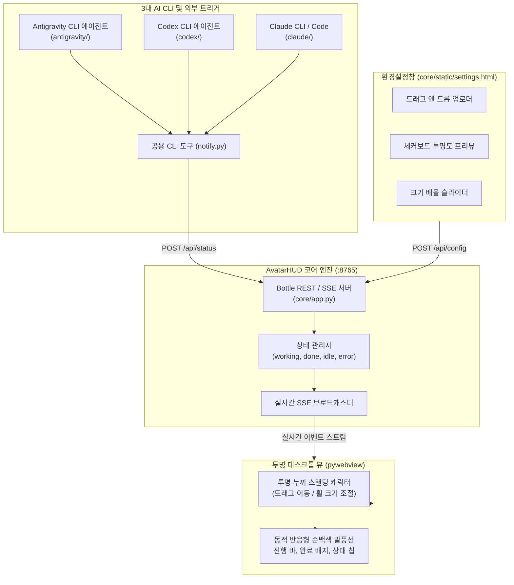

# AvatarHUD (투명 누끼 스탠딩 데스크톱 HUD)

[](LICENSE)
[](https://www.python.org/)
[](#3대-ai-cli-지원-안내)

사용자가 지정한 투명 누끼 스탠딩 인물/캐릭터(Transparent Cutout Standing PNG)가 윈도우 바탕화면에 자연스럽게 상시 상주하며, Antigravity CLI, Codex CLI, Claude CLI 에이전트의 실시간 작업 상태와 최종 완료 보고를 시각화해 주는 초경량 데스크톱 HUD 시스템입니다.

---

## 주요 특징 (Key Features)

1. **오로지 투명 누끼 스탠딩 모드 전용 (Transparent Cutout Standing Only)**:
   - 불필요한 사각 박스나 불투명 프레임을 배제하고, 배경이 투명한 인물/캐릭터 스탠딩 일러스트만 바탕화면에 자연스럽게 렌더링됩니다.
2. **상시 스탠딩 상주 (Persistent Desktop Companion)**:
   - 화면에서 숨거나 사라지지 않고 항상 바탕화면(원하는 위치)에 상주합니다.
   - 캐릭터를 마우스로 자유롭게 드래그하여 원하는 위치로 옮길 수 있으며, 마우스 휠로 크기를 자유롭게 확대/축소할 수 있습니다.
3. **만화풍 순백색 다이내믹 말풍선 (Clean Pure White Speech Bubble)**:
   - antiy-zunda 시그니처 순백색 카드 UI와 바운스 인 애니메이션 완벽 구현.
   - **작업 중 (Working)**: 블루 소프트 칩 + 단계(Step) 배지 + 부드러운 상태 표시.
   - **작업 완료 (Done)**: 경쾌한 바운스 효과 + 에메랄드 그린 완료 배지 + 소요 시간 태그 및 결과 요약.
   - **오류 발생 (Error)**: 레드 경고 배지 + 예외 상황 요약.
   - **대기 상태 (Idle)**: 화면을 가리지 않는 미니멀 순백색 말풍선.
4. **전용 그래픽 환경설정창 (Settings Window)**:
   - 탐색기에서 투명 누끼 이미지를 끌어다 놓기만 하면 즉시 반영되는 드래그 앤 드롭 업로더.
   - 투명도 확인을 위한 실시간 체커보드 프리뷰.
   - 캐릭터 크기 배율(Scale) 슬라이더 (50% ~ 200%).
   - 말풍선 상태별 실시간 발화 테스트 기능.
5. **3대 메이저 AI CLI 완벽 지원**:
   - Antigravity CLI, Codex CLI, Claude CLI (Claude Code) 전용 연동 디렉토리 및 규칙 파일 완비.
6. **클린 UI 표준**:
   - 프로젝트 전체 소스코드, UI, 문서에서 이모티콘을 배제한 깔끔하고 신뢰도 높은 디자인.

---

## 시스템 아키텍처



---

## 프로젝트 디렉토리 구조

```
avatar_hud/
├── README.md               # 프로젝트 전체 안내서
├── run.bat                 # 투명 HUD 원클릭 실행 스크립트
├── open_settings.bat       # 환경설정창 원클릭 실행 스크립트
├── requirements.txt        # 필요 파이썬 패키지 목록 (pywebview, bottle, requests, Pillow)
├── notify.py               # 루트 단축 알림 래퍼 도구
├── core/                   # [공통 코어 엔진]
│   ├── app.py              # pywebview 투명 윈도우 + 내장 REST/SSE 서버
│   ├── notify.py           # 상태 전송 메인 라이브러리 및 CLI 도구
│   ├── config.json         # HUD 기본 설정 (포트, 이미지, 스케일 등)
│   ├── test_flow.py        # 작업중 -> 갱신 -> 완료 -> 대기 시나리오 자동 검증 스크립트
│   └── static/             # 투명 오버레이 프론트엔드
│       ├── index.html      # 메인 뷰 (스탠딩 캐릭터 + 순백색 말풍선)
│       ├── settings.html   # 드래그 앤 드롭 캐릭터 교체 설정창
│       ├── style.css       # 투명 윈도우 및 말풍선 애니메이션 스타일시트
│       ├── app.js          # SSE 수신, 휠 줌, 실시간 상태 반영 UI 로직
│       └── default_avatar.png # 기본 제공 투명 누끼 일러스트
├── antigravity/            # [Antigravity CLI 전용]
│   ├── README.md           # Antigravity 연동 가이드
│   ├── skills/
│   │   └── avatar-hud/SKILL.md # Antigravity 에이전트 자동 보고 스킬
│   ├── hook.py             # 파이썬 수명주기 훅 래퍼
│   └── install_skill.bat   # 에이전트 스킬 원클릭 등록 배치파일
├── codex/                  # [Codex CLI 전용]
│   ├── README.md           # Codex 연동 가이드
│   ├── AGENTS.md           # Codex 에이전트 시스템 지침
│   ├── notify_codex.py     # Codex 최적화 알림 스크립트
│   └── codex_config.json   # Codex 설정 템플릿
└── claude/                 # [Claude CLI / Code 전용]
    ├── README.md           # Claude 연동 가이드
    ├── CLAUDE.md           # Claude Code 자동 인식 프로젝트 규칙
    ├── notify_claude.py    # Claude 전용 알림 어댑터
    └── setup_claude.bat    # Claude 연동 보조 배치파일
```

---

## 빠른 시작 (Quick Start)

### 1. 패키지 설치
```bash
pip install -r requirements.txt
```

### 2. AvatarHUD 실행
```bash
# 윈도우 원클릭 실행
run.bat

# 또는 파이썬 직접 실행
python core/app.py
```

### 3. 알림 테스트 (수동 호출)
새 터미널 창을 열고 아래 명령어로 캐릭터 말풍선이 실시간 반응하는지 확인합니다:
```bash
# 1) 작업 착수 알림
python notify.py --status working --title "데이터 분석 중" --msg "10만 건의 트랜잭션을 필터링하고 있습니다..." --step "1/3"

# 2) 진행 갱신 알림
python notify.py --status working --title "인공지능 모델 검증" --msg "테스트 세트 평가를 진행 중입니다..." --step "2/3"

# 3) 작업 완료 알림
python notify.py --status done --title "분석 및 모델 검증 완료!" --msg "정확도 98.4% 달성. 리포트 생성을 마쳤습니다." --elapsed 14

# 4) 대기 모드 복귀
python notify.py --status idle
```

---

## 3대 AI CLI 지원 안내

각 CLI 에이전트가 코딩 및 작업을 진행할 때 스스로 notify.py를 호출하여 바탕화면 캐릭터 말풍선에 보고하도록 사전에 완벽히 구성되어 있습니다.

### 1. Antigravity CLI ([antigravity/](./antigravity/README.md))
* `antigravity/install_skill.bat`을 실행하면 `%USERPROFILE%\.gemini\config\skills\avatar-hud\SKILL.md`로 자동 설치됩니다.
* Antigravity 세션에서 에이전트가 도구 착수/진행/완료 시 스스로 말풍선을 업데이트합니다.

### 2. Codex CLI ([codex/](./codex/README.md))
* `codex/AGENTS.md` 지침을 복사하여 사용자의 Codex 작업 환경에 배치합니다.
* Codex 에이전트가 단계별 실행 전후로 `codex/notify_codex.py`를 호출합니다.

### 3. Claude CLI / Claude Code ([claude/](./claude/README.md))
* 작업 대상 프로젝트 루트에 `claude/CLAUDE.md`를 위치시킵니다.
* Claude Code 에이전트가 시작, 중간 빌드/테스트, 최종 완료 시점에 스스로 `claude/notify_claude.py`를 호출합니다.

---

## 환경설정창 & 캐릭터 이미지 교체 가이드

사용자가 연예인 사진, 버튜버, 애니메이션 등 원하는 투명 누끼 PNG를 아주 쉽게 넣고 변경할 수 있도록 전용 그래픽 환경설정창을 제공합니다.

### 설정창 여는 3가지 방법
1. **바탕화면 캐릭터 우클릭**: 바탕화면에 서 있는 캐릭터를 마우스 오른쪽 클릭하면 즉시 설정창이 열립니다.
2. **호버 툴바의 SET 버튼 클릭**: 캐릭터에 마우스를 올렸을 때 나타나는 SET 버튼 클릭.
3. **원클릭 실행 파일**: 프로젝트 루트의 `open_settings.bat`을 더블 클릭하거나 웹 브라우저에서 `http://127.0.0.1:8765/settings` 접속.

### 이미지 변경 기능
* **드래그 앤 드롭 (Drag & Drop)**: 탐색기에서 투명 누끼 PNG/WebP 파일을 설정창의 점선 영역으로 끌어다 놓기만 하면 즉시 바탕화면에 실시간 반영됩니다.
* **실시간 체커보드 투명도 미리보기**: 투명 알파 채널이 잘 뚫려 있는지 체커보드 프리뷰로 확인 가능.
* **크기 배율 슬라이더**: 50% ~ 200% 배율을 슬라이더로 조절하여 바탕화면에 딱 맞는 크기로 맞춤.
* **말풍선 실시간 테스트**: 작업 중, 완료, 대기 상태를 설정창에서 즉시 버튼으로 테스트 가능.
* **기본 즌다몬 복구**: 언제든 원클릭으로 기본 즌다몬 스탠딩으로 초기화 가능.

---

## REST API 레퍼런스

HUD는 로컬 `http://127.0.0.1:8765`에서 경량 HTTP 서비스를 제공합니다:

| 엔드포인트 | 메서드 | 설명 | 페이로드 예시 |
|------------|--------|------|---------------|
| `/api/status` | `POST` | 상태 업데이트 및 SSE 브로드캐스트 | `{"status": "working", "title": "...", "message": "...", "step": "1/2"}` |
| `/api/status` | `GET` | 현재 상태 JSON 조회 | - |
| `/api/stream` | `GET` | 실시간 Server-Sent Events (SSE) 스트림 | - |
| `/api/config` | `GET`/`POST` | 이미지 경로, 스케일 등 환경설정 조회/저장 | `{"scale": 1.2}` |
| `/api/open_settings` | `POST` | 환경설정창 열기 | - |
| `/api/health` | `GET` | 서버 헬스체크 | - |

---

## 검증 스크립트 실행

```bash
# 서버 기동 후 자동 흐름 검증 실행
python core/test_flow.py
```
검증 항목: 서버 헬스체크 -> 작업 착수(1/3) -> 진행 갱신(2/3) -> 작업 완료 -> 대기 복귀 4단계 상태 전이 100% 자동 통과.

---

## 라이선스
MIT License (c) 2026 dotori-007
